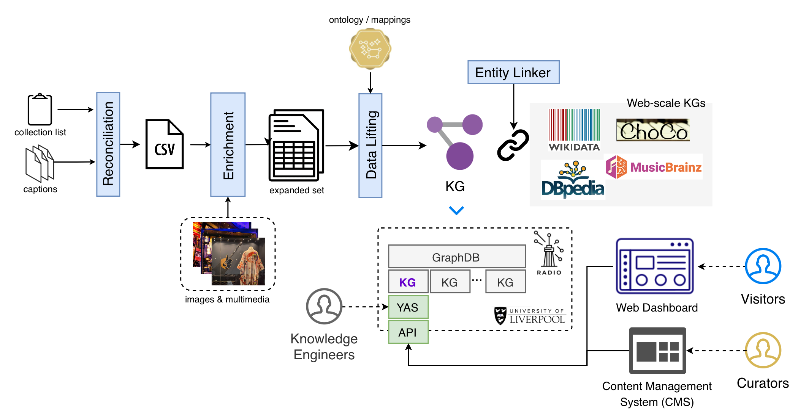

<div align="right">
    
    
</div>
<br>

# Linked Echoes

<table>
<tr>
<td width="72%">

**From spreadsheets to interconnected cultural assets: a low-barrier knowledge engineering workflow for music heritage ecosystems.**

Linked Echoes is an end-to-end, AI-assisted workflow that takes a cultural organisation from the data it *actually* has — a collection spreadsheet, caption documents, folders of images and audio — to a published, interconnected knowledge graph, and onwards to the services and applications built upon it.

It targets small and medium heritage organisations with no in-house knowledge engineering capacity: no ontological expertise is assumed, every automated stage is reviewable by curators, and generative components are constrained by a typed metamodel, retrieval over curated vocabularies, and symbolic validation.

</td>
<td width="28%" align="center">

</td>
</tr>
</table>

> [!IMPORTANT]
> **This repository contains the workflow.** The **BME Knowledge Graph** — the resource produced by applying Linked Echoes to the British Music Experience collection, with its triples and statistics — lives in [`onradio/bme-kg`](https://github.com/onradio/bme-kg) (currently private).

**Contents** · [Overview](#overview) · [What's in this repository](#whats-in-this-repository) · [Quickstart](#quickstart) · [Serving layer](#serving-layer) · [Applying it to your collection](#applying-it-to-your-collection) · [Case study: the BME](#case-study-the-british-music-experience) · [Ecosystem](#ecosystem) · [Citation](#citation)

---

## Overview

<p align="center">
  
</p>

The workflow is organised in two movements: a **knowledge construction** layer that turns legacy records into a knowledge graph, and a **knowledge serving** layer that deploys, maintains, and exposes it. Both are institution-agnostic.

### Knowledge construction

| # | Stage | What it does |
|---|-------|--------------|
| 0 | **Requirement engineering** | Participatory elicitation via personas, collaborative user stories, and competency questions (expert-driven, pattern-based, and LLM-based), validated on an expert-in-the-loop platform. See [`docs/requirements.md`](docs/requirements.md). |
| 1 | **Reconciliation** | Consolidates the collection spreadsheet, caption documents, and case-to-zone mappings into a single tabular representation, one row per object. |
| 2 | **Metadata completion** | LLMs expand each sparse record against the metamodel — musical context, locations, physical properties — under a structured-output contract, so every predicted value lands in a typed, reviewable field. |
| 3 | **Category & type classification** | Each object receives one of seven broad categories, then a fine-grained type selected by RAG over harmonised controlled vocabularies. |
| 4 | **Neuro-symbolic entity linking** | Entity mentions are looked up on Wikidata, pruned by SPARQL `ASK` type validators, and disambiguated in context by an LLM. Unlinkable mentions get newly minted URIs. |
| 5 | **Data lifting** | A modular triplifier materialises the graph from declarative mappings (`mappings.json`), with support for incremental updates. |

### Design principles

- **Low entry barrier** — the only prerequisite is data "as it is", typically a spreadsheet.
- **Human-in-the-loop** — every automated stage produces artefacts curators can inspect, correct, and approve, directly or through the CMS.
- **Grounded generation** — nothing enters the graph that is not attributable and checkable.
- **Progressive semantics** — the first iteration is grounded in schema.org with objects dually typed as `crm:E22_Human-Made_Object`, keeping the path to Linked Art and CIDOC-CRM open. Because triplification is mapping-driven, that progression is an engineering task, not a re-modelling effort.

### The metamodel

A typed data layer (pydantic models) that validates every record, acts as the structured-output contract for the LLM components, and is the single source from which the declarative mappings are defined.

| Group | Attributes |
|-------|-----------|
| Core metadata | identifier, name, description, caption |
| Cataloguing info | category, type, case number, exhibition |
| Physical properties | colour, material |
| Multimedia & links | images, audios, videos, URLs |
| Musical context | genres, music works, music albums, music artists, events |
| Location | countries, places, venues |
| Loan information | lender, loan start, loan end |

**Categories.** Each object is assigned one main category — the broadest classification it can receive, and the root of whatever taxonomy a deployment wishes to adopt. A small number of objects genuinely straddle categories (John Lennon's glasses are both Clothing and Personal Effects), which the metamodel admits.
 
| Category | Description |
|----------|-------------|
| Musical Instrument | Instruments and sound equipment used in musical performance and production (guitars, keyboards, amplifiers) |
| Clothing | Garments and accessories worn on the body, including stage costumes and fashion items |
| Audiovisual Media | Carriers of recorded sound and moving image (vinyl records, tapes, discs, film) |
| Textual & Graphic Work | Written, printed, and graphic matter (manuscripts, lyrics, sheet music, posters, photographs, artwork) |
| Merchandise | Commercially produced goods associated with artists, tours, or releases (t-shirts, badges, programmes) |
| Personal Effects | Privately owned items normally worn or carried by a person (glasses, jewellery, personal documents) |
| Award & Recognition | Honours conferred to recognise merit or achievement (certified discs, trophies, certificates) |


### Harmonised vocabularies

Fine-grained types resolve to curated, dereferenceable concepts. With the exception of AAT, none of these resources is distributed as RDF; each was parsed and normalised into a common scheme (term, label, description, multilingual labels where available) and released in RDF, then consolidated into the dataset from which the retrieval indices are built — roughly **50,000 terms**.

| Vocabulary | Categories served | #Terms |
|------------|-------------------|--------|
| [MIMO](https://vocabulary.mimo-international.com) | Musical Instrument | 2,324 |
| [PBCore](https://pbcore.org) | Audiovisual Media | 93 |
| [Europeana Fashion](http://thesaurus.europeanafashion.eu) | Clothing | 1,481 |
| [Getty AAT](https://www.getty.edu/research/tools/vocabularies/aat/) | Textual & Graphic Work; Merchandise; Personal Effects; Award & Recognition | 46,403 |

<!-- TODO: add the release location and licence of the harmonised RDF vocabularies. -->

---

## What's in this repository

```
lechoes/
├── src/                  # the workflow: extraction, classification, linking, triplification
│   ├── ingest_pipeline.py    # end-to-end entry point (raw descriptions → TTL)
│   ├── vocabularies/         # harmonised vocabularies (all_concepts.csv) and their sources
│   ├── kg_expansion/         # Wikidata expansion, enrichment, SHACL and the release gate
│   ├── metadata_curation/    # extraction prompts and config used by the pipeline
│   ├── routes/, queries/     # the REST API's endpoints and SPARQL
│   └── *.ipynb               # walkthroughs: classification, linking, population
├── eval/                 # the experiments behind the paper, one pack per section
├── main.py               # the REST API (FastAPI)
├── mappings.json         # declarative mappings: API
└── mappings_min.json     # declarative mappings: construction pipeline
```

The repository holds the workflow only. An institution's data (its collection exports, the graphs built from them, and their releases) lives in that institution's own repository: for the BME, [`onradio/bme-kg`](https://github.com/onradio/bme-kg). Deployment lives in [`onradio/bme-linkedechoes`](https://github.com/onradio/bme-linkedechoes). Both are currently private.

---

## Quickstart

### 1. Set up the environment

```bash
# TODO: replace with the actual environment setup (venv / conda / requirements.txt)
cd lechoes/src
```

You will need an LLM API key (the reference configuration uses Gemini 2.5 Pro/Flash). The workflow is deliberately model-agnostic: generative components interact with the pipeline exclusively through the typed metamodel contract, so open-weight models can be substituted without architectural change.

### 2. Build the vocabulary vector databases

Terms are embedded with `all-MiniLM-L6-v2` and indexed with FAISS, one index per vocabulary, so that the predicted category routes each query to the right index. The indices are not distributed with the repository (`vectordb/` is gitignored) and must be built once before any classification runs.

All commands below are run from `lechoes/src/`, because [`classification.py`](lechoes/src/classification.py) resolves `VOCAB_PATHS` relative to that directory.

#### Two index variants

Each vocabulary is indexed twice, under the two embedding strategies exposed by `--index_strategy`:

| Strategy | Text embedded | Built as | Purpose |
|----------|---------------|----------|---------|
| `term` | the term label alone (`"kimonos"`) | `<vocab>.index` | the variant the pipeline loads by default |
| `combine` | label + scope note (`"kimonos: Loose, wide-sleeved garments…"`) | `<vocab>_combine.index` | richer signal where definitions exist; compared against `term` in the retrieval experiments |

Both are needed: definition coverage is uneven across the harmonised vocabularies — 100% for AAT and PBCore, 80.6% for Europeana Fashion, and 41.1% for MIMO — so under `combine` a MIMO query is matching against a bare `"term: "` string for most instruments. Which strategy wins is therefore an empirical question per vocabulary, not a global default.

The two variants sit side by side in the same `vectordb/` directory and differ only in `--vocabulary_name`, so a build never overwrites the other. Each build writes `<name>.index` (the FAISS index) and `<name>_metadata.pkl` (the term rows, in index order).

#### Build commands

**Getty AAT** — Textual & Graphic Work, Merchandise, Personal Effects, Award & Recognition (46,403 terms; a few minutes per build):

```bash
python classification.py build --vocabulary vocabularies/all_concepts.csv \
    --subset AAT --model_name all-MiniLM-L6-v2 \
    --index_strategy term --output_dir vocabularies/aat/vectordb --vocabulary_name aat

python classification.py build --vocabulary vocabularies/all_concepts.csv \
    --subset AAT --model_name all-MiniLM-L6-v2 \
    --index_strategy combine --output_dir vocabularies/aat/vectordb --vocabulary_name aat_combine
```

**MIMO** — Musical Instrument (2,324 terms):

```bash
python classification.py build --vocabulary vocabularies/all_concepts.csv \
    --subset MIMO --model_name all-MiniLM-L6-v2 \
    --index_strategy term --output_dir vocabularies/mimo/vectordb --vocabulary_name mimo

python classification.py build --vocabulary vocabularies/all_concepts.csv \
    --subset MIMO --model_name all-MiniLM-L6-v2 \
    --index_strategy combine --output_dir vocabularies/mimo/vectordb --vocabulary_name mimo_combine
```

**Europeana Fashion** — Clothing (1,481 terms). Note the asymmetry: the `source_vocabulary` value in the CSV is `Europeana`, while the directory and index name are `fashion`, which is what `VOCAB_PATHS` looks for:

```bash
python classification.py build --vocabulary vocabularies/all_concepts.csv \
    --subset Europeana --model_name all-MiniLM-L6-v2 \
    --index_strategy term --output_dir vocabularies/fashion/vectordb --vocabulary_name fashion

python classification.py build --vocabulary vocabularies/all_concepts.csv \
    --subset Europeana --model_name all-MiniLM-L6-v2 \
    --index_strategy combine --output_dir vocabularies/fashion/vectordb --vocabulary_name fashion_combine
```

**PBCore** — Audiovisual Media (93 terms, across two subsets):

```bash
python classification.py build --vocabulary vocabularies/all_concepts.csv \
    --subset PBCore-AssetType PBCore-Instantiation --model_name all-MiniLM-L6-v2 \
    --index_strategy term --output_dir vocabularies/pbcore/vectordb --vocabulary_name pbcore

python classification.py build --vocabulary vocabularies/all_concepts.csv \
    --subset PBCore-AssetType PBCore-Instantiation --model_name all-MiniLM-L6-v2 \
    --index_strategy combine --output_dir vocabularies/pbcore/vectordb --vocabulary_name pbcore_combine
```

The resulting layout:

```
lechoes/src/vocabularies/
├── all_concepts.csv                   # 50,301 harmonised terms — the input to every build
├── aat/vectordb/{aat,aat_combine}.{index,_metadata.pkl}
├── mimo/vectordb/{mimo,mimo_combine}.{index,_metadata.pkl}
├── fashion/vectordb/{fashion,fashion_combine}.{index,_metadata.pkl}
└── pbcore/vectordb/{pbcore,pbcore_combine}.{index,_metadata.pkl}
```

#### Selecting a variant

`HierarchicalObjectClassifier` loads the four `term` indices listed in `VOCAB_PATHS`. To run against the `combine` variant, either point `VOCAB_PATHS` at the `_combine` names or construct a `RAGObjectClassifier` directly:

```python
from classification import RAGObjectClassifier

classifier = RAGObjectClassifier(
    index_path="vocabularies/mimo/vectordb/mimo_combine.index",
    metadata_path="vocabularies/mimo/vectordb/mimo_combine_metadata.pkl",
    embedding_model="all-MiniLM-L6-v2",
    generator_model="gemini-2.5-flash",
    generator_api_key="YOUR_GEMINI_API_KEY",
)
```

Retrieval must use the same embedding model the index was built with; mixing them silently returns nonsense neighbours rather than failing.

#### Rebuilding `all_concepts.csv` from the sources

The consolidated CSV is committed, so this step is only needed to refresh the vocabularies from upstream. Each source is harmonised into `term, definition, uri, source_vocabulary` by the *Preparing the vocabularies* section of [`lechoes/src/classification.ipynb`](lechoes/src/classification.ipynb): AAT via Getty's SPARQL endpoint, PBCore from the released spreadsheets, MIMO from the DOREMUS Turtle dump with definitions back-filled from DBpedia and Wikidata (MIMO's own thesaurus carries none), and Europeana Fashion from its RDF/XML. The notebook's *Collate and save* cell concatenates the four into `vocabularies/all_concepts.csv`. Provenance and per-vocabulary detail: [`lechoes/src/vocabularies/README.md`](lechoes/src/vocabularies/README.md).

### 3. Run the pipeline and generate triples

From raw object descriptions (extraction → classification → linking → triplification):

```bash
python ingest_pipeline.py path/to/collection.csv \
  --api-key YOUR_GEMINI_API_KEY \
  --output-dir path/to/output
```

The collection's layout files (`zone_definitions.csv`, `zone_case_mappings.csv`) are read from beside the CSV, or from `--layout-dir`. Flags, resume/retry and the output layout: [`lechoes/src/INGEST_PIPELINE.md`](lechoes/src/INGEST_PIPELINE.md). If the CSV is already structured against the metamodel, `populate.py` runs the same pipeline without the extraction stage and takes the same `--api-key` / `--output-dir` flags.

<!-- TODO: document the remaining CLI flags (granularity mode, role conditioning, top-N, temperature) and add a worked end-to-end example notebook. -->

---

## Serving layer

A graph that cannot be queried, maintained, and embedded in day-to-day systems delivers little value. The serving stack is released as a set of Docker containers so it can be instantiated on an institution's own infrastructure. The REST API's code lives here (`lechoes/main.py`, `lechoes/src/routes/`, `lechoes/src/queries/`). The containers, routing, triplestore configuration and deploy scripts live in [`onradio/bme-linkedechoes`](https://github.com/onradio/bme-linkedechoes) (currently private), the reference deployment for the BME.

| Component | Role |
|-----------|------|
| **Triplestore** | GraphDB, one repository per collection (or per version), so several collections can be hosted side by side and queried federatively. Administered through the GraphDB Workbench, password-protected via Apache `htpasswd`. |
| **SPARQL endpoint + YASGUI** | Public, exploratory access for researchers and developers. |
| **REST API** | FastAPI. **All applications access the graph exclusively through it** — no application embeds SPARQL or keeps a private copy of the catalogue. Multi-layered access rights (read-only → curatorial → maintainer) with JWT (OAuth2). Responses are JSON shaped by the metamodel, each leaf value a `(label, URI)` pair. |
| **CMS integration** | Strapi adapted to operate on knowledge graphs through the API: curators review machine-generated values, complete metadata, and register objects without ever seeing RDF. Approved changes propagate back through incremental triplification. |

---

## Applying it to your collection

Little in Linked Echoes is specific to any one museum. Porting the workflow reduces to:

1. **Reconcile your legacy formats** into the consolidated tabular representation (stage 1).
2. **Revise the category set** if your holdings need it — categories are configuration, not code.
3. **Swap the domain vocabularies** if you are outside music, retaining the architecture.
4. **Adjust the `ASK` validators**, which are per-type templates, and the declarative mappings.
5. **Deploy the serving stack** in Docker, on the model of the BME's deployment ([`bme-linkedechoes`](https://github.com/onradio/bme-linkedechoes), currently private), and point the CMS at it.

<!-- TODO: link a step-by-step porting guide once available. -->

**Current limitations.** The predictive components were evaluated on a 60-object gold standard; broader claims need larger samples and further institutions. Strict-archivist prompting privileges precision, so human curators remain essential for completeness. The workflow has so far been validated on English-language records and Anglo-centric popular music. An instance must currently be self-hosted; support for Wikibase-backed deployment and ECCCH integration is planned.

---

## Case study: the British Music Experience

Linked Echoes was developed and validated with the [British Music Experience](https://britishmusicexperience.com), the UK's museum of popular music. Applying it to the museum's legacy data produced the **BME Knowledge Graph** (v1.1): 9,755 triples over 1,836 entities, describing 514 objects, with 2,375 entity annotations linked to Wikidata and, transitively, to MusicBrainz, DBpedia, and the wider Web of music data.

**➡️ Triples, statistics, and releases: [`onradio/bme-kg`](https://github.com/onradio/bme-kg)** (currently private)

<!-- TODO: add the public SPARQL endpoint URL and the citable identifier for the resource. -->

---

## Ecosystem

Applications built on top of the knowledge layer, each maintained separately. These repositories are currently private.

| Repository | What it is |
|------------|-----------|
| [`bme-kg`](https://github.com/onradio/bme-kg) | The BME Knowledge Graph: triples, statistics, releases, and the collection data they are built from |
| [`bme-linkedechoes`](https://github.com/onradio/bme-linkedechoes) | Deployment of the whole BME ecosystem (API, triplestore, dashboard, CMS) |
| [`bme-dashboard`](https://github.com/onradio/bme-dashboard) | Public web dashboard for browsing and searching the collection, following its links out to Wikidata |
| [`bme-cms`](https://github.com/onradio/bme-cms) | Curatorial CMS for adding, editing, and removing objects |
| [`bme-aidt`](https://github.com/onradio/bme-aidt) | AI Digital Timeline: music events from 1945 to the present, connected to collection objects through shared entities |

---

## Citation

If you use Linked Echoes, please cite:

```bibtex
@article{deberardinis2026linkedechoes,
  title   = {From Spreadsheets to Interconnected Cultural Assets: a Low-Barrier Knowledge Engineering Workflow for Music Heritage Ecosystems},
  author  = {de Berardinis, Jacopo and Alharbi, Reham and Barla, Sowjanya Naga and Nandagopal, Prakash and Tripathi, Aradhya, Koravos, Elizabeth and Taylor, Oliver and Tamma, Valentina},
  year    = {2026},
  note    = {Preprint}
}
```

## Licence

The code is released under the [MIT Licence](LICENSE).

<!-- TODO: state the licence for the harmonised vocabularies and the evaluation data. -->

## Acknowledgements

Supported by UK Research and Innovation (UKRI) through EPSRC and AHRC, grant **EP/X525741/1**. We are grateful to the British Music Experience for their sustained collaboration throughout the co-creation process.