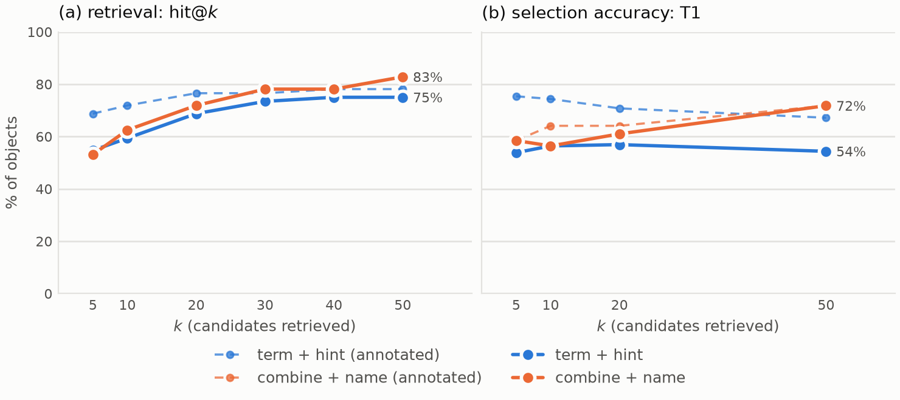
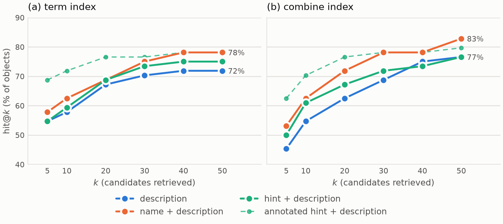

# Classification evaluation — deliverables

Generated by `report.py` from `data/results/`. Every number is computed in `score.py`; nothing here is hand-edited.

## Figure — retrieval and selection accuracy

Panel (a) is the share of objects whose accepted gold term appears in the top $k$, with the AAT fallback pool included; panel (b) is the accuracy of the LLM selector over the same pools. Both panels share one percentage axis. Solid lines use the type predicted by metadata completion as the hint; dashed lines repeat the first sweep, run with the annotated type. Combine + name does not use the hint in its query, so its two lines coincide in panel (a).

## Table 3 — the full retrieval grid

Every retrieval configuration at every depth, over the 64 objects whose gold term is reachable. The last column marks those carried into the selection experiment. `hint` is the type predicted by metadata completion; `annotated hint` is the annotated object type, an oracle input (see `check_type_hint.py`).

| Index | Query | @5 | @10 | @20 | @30 | @40 | @50 | MRR@50 | Selection |
|---|---|---|---|---|---|---|---|---|---|
| term | description | 54.7 | 57.8 | 67.2 | 70.3 | 71.9 | 71.9 | 0.388 | -- |
| term | name + description | 57.8 | 62.5 | 68.8 | 75.0 | 78.1 | 78.1 | 0.478 | -- |
| term | hint + description | 54.7 | 59.4 | 68.8 | 73.4 | 75.0 | 75.0 | 0.452 | yes |
| term | annotated hint + description | 68.8 | 71.9 | 76.6 | 76.6 | 78.1 | 78.1 | 0.602 | yes |
| combine | description | 45.3 | 54.7 | 62.5 | 68.8 | 75.0 | 76.6 | 0.345 | -- |
| combine | name + description | 53.1 | 62.5 | 71.9 | 78.1 | 78.1 | 82.8 | 0.370 | yes |
| combine | hint + description | 50.0 | 60.9 | 67.2 | 71.9 | 73.4 | 76.6 | 0.388 | -- |
| combine | annotated hint + description | 62.5 | 70.3 | 76.6 | 78.1 | 78.1 | 79.7 | 0.481 | -- |

One panel per index strategy, one line per query formulation; the annotated hint is dashed. **The vertical axis begins at 40%**, not zero — the table above carries every value exactly.

### Companion — hit@10 by query formulation

| Index | description | name + desc. | hint + desc. | annotated hint + desc. |
|---|---|---|---|---|
| term | 57.8 | 62.5 | 59.4 | 71.9 |
| combine | 54.7 | 62.5 | 60.9 | 70.3 |

## Table 1 — category classification

| System | Acc. | Strict | Macro-P | Macro-R | Macro-F1 | McNemar $p$ |
|---|---|---|---|---|---|---|
| C0 majority class | 60.0 | 60.0 | 15.0 | 25.0 | 18.8 | -- |
| C1 nearest definition | 26.2 | 24.6 | 59.9 | 37.0 | 37.2 | -- |
| C2 LLM (ours) | 97.9 | 97.4 | 100.0 | 98.4 | 99.2 | -- |

A richer prompt carrying the seven scope notes and eight worked examples (`C2-scoped`) was evaluated and did not improve accuracy: 100.0% against C2's 97.9%, one discordant object, McNemar $p = 1.0$. The simpler 

## Table 2 — type classification

| Retrieval | Sys. | $k$ | Acc. | 95\% CI | Term P | Term R | F1 | Abst. (den.) | hit@$k$ | $p$ vs T0 |
|---|---|---|---|---|---|---|---|---|---|---|
| term + hint | T0 | -- | 33.8 | [22.2, 46.2] | 33.8 | 34.4 | 34.1 | -- | -- | -- |
| term + hint | T1 | 5 | 53.8 | [41.8, 65.2] | 64.2 | 46.7 | 54.1 | 57.8 (15) | 54.7 | 0.002 |
| term + hint | T1 | 10 | 56.4 | [42.6, 69.3] | 63.0 | 50.6 | 56.1 | 51.1 (15) | 59.4 | $<$0.001 |
| term + hint | T1 | 20 | 56.9 | [42.1, 71.1] | 60.4 | 52.5 | 56.2 | 42.9 (14) | 68.8 | 0.001 |
| term + hint | T1 | 50 | 54.4 | [38.5, 69.2] | 57.9 | 52.7 | 55.2 | 17.9 (13) | 75.0 | 0.004 |
| combine + name | T0 | -- | 26.2 | [15.4, 38.5] | 26.2 | 26.6 | 26.4 | -- | -- | -- |
| combine + name | T1 | 5 | 58.5 | [44.4, 71.6] | 71.0 | 53.4 | 61.0 | 70.0 (10) | 53.1 | $<$0.001 |
| combine + name | T1 | 10 | 56.4 | [42.1, 69.8] | 69.3 | 52.8 | 59.9 | 55.6 (9) | 62.5 | $<$0.001 |
| combine + name | T1 | 20 | 61.0 | [46.2, 74.9] | 70.7 | 57.8 | 63.6 | 62.5 (8) | 71.9 | $<$0.001 |
| combine + name | T1 | 50 | 71.8 | [55.2, 86.2] | 76.8 | 70.1 | 73.3 | 52.4 (7) | 82.8 | $<$0.001 |
| term + hint (annotated) | T0 | -- | 44.6 | [31.7, 57.1] | 44.6 | 45.3 | 45.0 | -- | -- | -- |
| term + hint (annotated) | T1 | 5 | 75.4 | [64.6, 85.1] | 78.4 | 71.4 | 74.8 | 60.0 (15) | 68.8 | $<$0.001 |
| term + hint (annotated) | T1 | 10 | 74.4 | [63.5, 84.6] | 74.2 | 70.8 | 72.5 | 53.3 (15) | 71.9 | $<$0.001 |
| term + hint (annotated) | T1 | 20 | 70.8 | [59.3, 82.1] | 71.5 | 68.3 | 69.9 | 35.7 (14) | 76.6 | $<$0.001 |
| term + hint (annotated) | T1 | 50 | 67.2 | [55.6, 78.8] | 68.9 | 66.7 | 67.7 | 12.8 (13) | 78.1 | $<$0.001 |
| combine + name (annotated) | T0 | -- | 26.2 | [15.4, 38.5] | 26.2 | 26.6 | 26.4 | -- | -- | -- |
| combine + name (annotated) | T1 | 5 | 58.5 | [44.6, 72.3] | 72.1 | 53.4 | 61.4 | 70.0 (10) | 53.1 | $<$0.001 |
| combine + name (annotated) | T1 | 10 | 64.1 | [51.2, 76.2] | 76.4 | 60.5 | 67.5 | 66.7 (9) | 62.5 | $<$0.001 |
| combine + name (annotated) | T1 | 20 | 64.1 | [49.7, 77.8] | 74.8 | 61.1 | 67.3 | 62.5 (8) | 71.9 | $<$0.001 |
| combine + name (annotated) | T1 | 50 | 71.8 | [55.6, 86.2] | 75.6 | 70.3 | 72.8 | 47.6 (7) | 82.8 | $<$0.001 |

## Paired comparisons

McNemar on the modal outcome across runs. The depth comparisons are the ones the unpaired intervals cannot settle, since the cells share objects.

| Comparison | Configuration | $k$ | Discordant | Favours first | Favours second | $p$ |
|---|---|---|---|---|---|---|
| T1 k=5 vs T1 k=10 | combine_name | 10 | 4 | 0 | 4 | 0.125 |
| T1 k=5 vs T1 k=20 | combine_name | 20 | 10 | 3 | 7 | 0.344 |
| T1 k=5 vs T1 k=50 | combine_name | 50 | 17 | 4 | 13 | 0.049 |
| T1 k=5 vs T1 k=10 | combine_name_predhint | 10 | 4 | 3 | 1 | 0.625 |
| T1 k=5 vs T1 k=20 | combine_name_predhint | 20 | 9 | 4 | 5 | 1.000 |
| T1 k=5 vs T1 k=50 | combine_name_predhint | 50 | 13 | 2 | 11 | 0.022 |
| T1 k=5 vs T1 k=10 | term_hint | 10 | 7 | 4 | 3 | 1.000 |
| T1 k=5 vs T1 k=20 | term_hint | 20 | 10 | 6 | 4 | 0.754 |
| T1 k=5 vs T1 k=50 | term_hint | 50 | 11 | 8 | 3 | 0.227 |
| T1 k=5 vs T1 k=10 | term_predhint | 10 | 6 | 2 | 4 | 0.688 |
| T1 k=5 vs T1 k=20 | term_predhint | 20 | 10 | 4 | 6 | 0.754 |
| T1 k=5 vs T1 k=50 | term_predhint | 50 | 16 | 8 | 8 | 1.000 |
| T1 term_hint vs T1 combine_name | term_hint vs combine_name | 5 | 21 | 16 | 5 | 0.027 |
| T1 term_predhint vs T1 combine_name_predhint | term_predhint vs combine_name_predhint | 5 | 11 | 4 | 7 | 0.549 |
| T1 term_hint vs T1 term_predhint | term_hint vs term_predhint | 5 | 14 | 14 | 0 | <0.001 |
| T1 combine_name vs T1 combine_name_predhint | combine_name vs combine_name_predhint | 5 | 2 | 1 | 1 | 1.000 |
| T1 term_hint vs T1 combine_name | term_hint vs combine_name | 10 | 22 | 14 | 8 | 0.286 |
| T1 term_predhint vs T1 combine_name_predhint | term_predhint vs combine_name_predhint | 10 | 11 | 6 | 5 | 1.000 |
| T1 term_hint vs T1 term_predhint | term_hint vs term_predhint | 10 | 15 | 13 | 2 | 0.007 |
| T1 combine_name vs T1 combine_name_predhint | combine_name vs combine_name_predhint | 10 | 6 | 6 | 0 | 0.031 |
| T1 term_hint vs T1 combine_name | term_hint vs combine_name | 20 | 19 | 12 | 7 | 0.359 |
| T1 term_predhint vs T1 combine_name_predhint | term_predhint vs combine_name_predhint | 20 | 14 | 6 | 8 | 0.791 |
| T1 term_hint vs T1 term_predhint | term_hint vs term_predhint | 20 | 14 | 12 | 2 | 0.013 |
| T1 combine_name vs T1 combine_name_predhint | combine_name vs combine_name_predhint | 20 | 3 | 3 | 0 | 0.250 |
| T1 term_hint vs T1 combine_name | term_hint vs combine_name | 50 | 15 | 6 | 9 | 0.607 |
| T1 term_predhint vs T1 combine_name_predhint | term_predhint vs combine_name_predhint | 50 | 12 | 0 | 12 | <0.001 |
| T1 term_hint vs T1 term_predhint | term_hint vs term_predhint | 50 | 11 | 10 | 1 | 0.012 |
| T1 combine_name vs T1 combine_name_predhint | combine_name vs combine_name_predhint | 50 | 2 | 1 | 1 | 1.000 |
| C2 [google-gemini-2-5-flash] vs C0 | category | -- | 27 | 1 | 26 | <0.001 |
| C2 [google-gemini-2-5-flash] vs C1 | category | -- | 47 | 0 | 47 | <0.001 |
| C2 [google-gemini-2-5-flash] vs C2-scoped [google-gemini-2-5-flash] | category | -- | 1 | 1 | 0 | 1.000 |
