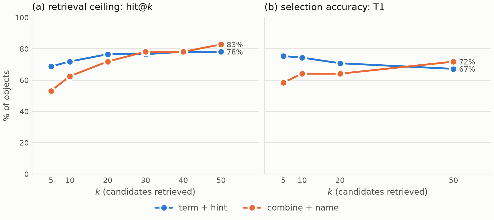
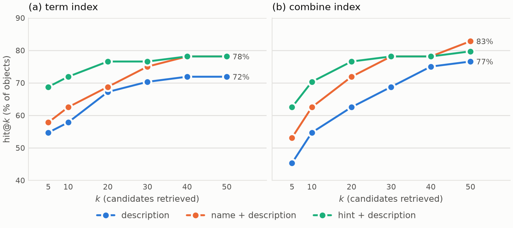

# Classification evaluation — deliverables

Generated by `report.py` from `data/results/`. Every number is computed in `score.py`; nothing here is hand-edited.

## Figure — retrieval ceiling and selection accuracy

Panel (a) is the share of objects whose accepted gold term appears in the top $k$, with the AAT fallback pool included; panel (b) is the accuracy of the LLM selector over the same pools. Both panels share one percentage axis.

## Table 3 — the full retrieval grid

All six retrieval configurations at every depth, over the 64 objects whose gold term is reachable. The last column marks the two carried into the selection experiment.

| Index | Query | @5 | @10 | @20 | @30 | @40 | @50 | MRR@50 | Selection |
|---|---|---|---|---|---|---|---|---|---|
| term | description | 54.7 | 57.8 | 67.2 | 70.3 | 71.9 | 71.9 | 0.388 | -- |
| term | name + description | 57.8 | 62.5 | 68.8 | 75.0 | 78.1 | 78.1 | 0.478 | -- |
| term | hint + description | 68.8 | 71.9 | 76.6 | 76.6 | 78.1 | 78.1 | 0.602 | yes |
| combine | description | 45.3 | 54.7 | 62.5 | 68.8 | 75.0 | 76.6 | 0.345 | -- |
| combine | name + description | 53.1 | 62.5 | 71.9 | 78.1 | 78.1 | 82.8 | 0.370 | yes |
| combine | hint + description | 62.5 | 70.3 | 76.6 | 78.1 | 78.1 | 79.7 | 0.481 | -- |

One panel per index strategy, one line per query formulation. The type hint dominates on the term index at every depth; on the combine index it leads early and is overtaken by name + description at $k=50$. **The vertical axis begins at 40%**, not zero — the table above carries every value exactly.

### Companion — hit@10 by query formulation

| Index | description | name + desc. | hint + desc. |
|---|---|---|---|
| term | 57.8 | 62.5 | 71.9 |
| combine | 54.7 | 62.5 | 70.3 |

## Table 1 — category classification

| System | Acc. | Strict | Macro-P | Macro-R | Macro-F1 | McNemar $p$ |
|---|---|---|---|---|---|---|
| C0 majority class | 60.0 | 60.0 | 15.0 | 25.0 | 18.8 | -- |
| C1 nearest definition | 26.2 | 24.6 | 59.9 | 37.0 | 37.2 | -- |
| C2 LLM (ours) | 98.0 | 97.4 | 100.0 | 98.4 | 99.2 | -- |

A richer prompt carrying the seven scope notes and eight worked examples (`C2-scoped`) was evaluated and did not improve accuracy: 100.0% against C2's 98.0%, one discordant object, McNemar $p = 1.0$. The simpler 

## Table 2 — type classification

| Retrieval | Sys. | $k$ | Acc. | Term P | Term R | F1 | Abst. | hit@$k$ | $p$ vs T0 |
|---|---|---|---|---|---|---|---|---|---|
| term + hint | T0 | -- | 44.6 | 44.6 | 45.3 | 45.0 | -- | -- | -- |
| term + hint | T1 | 5 | 75.4 | 78.4 | 71.4 | 74.8 | 60.0 | 68.8 | $<$0.001 |
| term + hint | T1 | 10 | 74.4 | 74.2 | 70.8 | 72.5 | 53.3 | 71.9 | $<$0.001 |
| term + hint | T1 | 20 | 70.8 | 71.5 | 68.3 | 69.9 | 35.7 | 76.6 | $<$0.001 |
| term + hint | T1 | 50 | 67.2 | 68.8 | 66.7 | 67.7 | 12.8 | 78.1 | $<$0.001 |
| combine + name | T0 | -- | 26.2 | 26.2 | 26.6 | 26.4 | -- | -- | -- |
| combine + name | T1 | 5 | 58.5 | 72.1 | 53.4 | 61.4 | 70.0 | 53.1 | $<$0.001 |
| combine + name | T1 | 10 | 64.1 | 76.4 | 60.5 | 67.5 | 66.7 | 62.5 | $<$0.001 |
| combine + name | T1 | 20 | 64.1 | 74.8 | 61.1 | 67.3 | 62.5 | 71.9 | $<$0.001 |
| combine + name | T1 | 50 | 71.8 | 75.6 | 70.3 | 72.8 | 47.6 | 82.8 | $<$0.001 |

## Paired comparisons

McNemar on the modal outcome across runs. The depth comparisons are the ones the unpaired intervals cannot settle, since the cells share objects.

| Comparison | Configuration | $k$ | Discordant | Favours first | Favours second | $p$ |
|---|---|---|---|---|---|---|
| T1 k=5 vs T1 k=10 | combine_name | 10 | 4 | 0 | 4 | 0.125 |
| T1 k=5 vs T1 k=20 | combine_name | 20 | 10 | 3 | 7 | 0.344 |
| T1 k=5 vs T1 k=50 | combine_name | 50 | 17 | 4 | 13 | 0.049 |
| T1 k=5 vs T1 k=10 | term_hint | 10 | 7 | 4 | 3 | 1.000 |
| T1 k=5 vs T1 k=20 | term_hint | 20 | 10 | 6 | 4 | 0.754 |
| T1 k=5 vs T1 k=50 | term_hint | 50 | 11 | 8 | 3 | 0.227 |
| T1 term_hint vs T1 combine_name | term_hint vs combine_name | 5 | 21 | 16 | 5 | 0.027 |
| T1 term_hint vs T1 combine_name | term_hint vs combine_name | 10 | 22 | 14 | 8 | 0.286 |
| T1 term_hint vs T1 combine_name | term_hint vs combine_name | 20 | 19 | 12 | 7 | 0.359 |
| T1 term_hint vs T1 combine_name | term_hint vs combine_name | 50 | 15 | 6 | 9 | 0.607 |
| C2 [google-gemini-2-5-flash] vs C0 | category | -- | 27 | 1 | 26 | <0.001 |
| C2 [google-gemini-2-5-flash] vs C1 | category | -- | 47 | 0 | 47 | <0.001 |
| C2 [google-gemini-2-5-flash] vs C2-scoped [google-gemini-2-5-flash] | category | -- | 1 | 1 | 0 | 1.000 |
