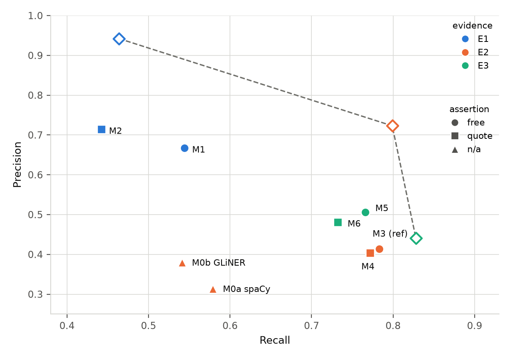

# Evaluation of metadata extraction

*Draft material for Section 4.2 of the Linked Echoes article (Knowledge-Based Systems). Every
figure quoted here is produced by `score.py` from the prediction files in `data/predictions/` and
formatted by `report.py`; nothing is transcribed by hand. The prose numbers are additionally
emitted as `latex/macros.tex` so a sentence in the article cannot quote a stale figure. The
companion `data/results/report.md` carries the same tables without the discussion; the
implementation contract is `metadata_extraction_evaluation_spec.md`.*

| Deliverable | Source | Placement |
| --- | --- | --- |
| Figure 1 — the operating plane | `data/results/figures/operating_plane.pdf` | §4.2, main text |
| Table 1 — systems | `data/results/latex/table1_systems.tex` | §4.2, main text |
| Table 2 — per field | `data/results/latex/table2_per_field.tex` | §4.2, main text |
| Prose numbers | `data/results/latex/macros.tex` | inline |

---

## 1. What is measured, and what the section claims

The construction pipeline's first stage reads a museum object's free-text record and returns an
instance of the metamodel: values for 14 fields, of which 11 are scored here. The question this
section answers is not "how good is the extractor" but **what operating points the workflow
supports, and what imposes them**.

The claim the evaluation is built to establish is that the limit on precision is **a property of
the source material rather than of the prompt**. The museum's captions are written at
display-case granularity: one caption describes several objects standing together. An extractor
that returns everything its input contains therefore misattributes systematically, and no amount
of prompt engineering removes the problem, because the offending values genuinely are in the text.
What can be done is to tell the model which neighbours it is looking at and ask it to decide. The
experiment isolates exactly that.

Two decisions frame everything below. **No configuration is privileged**: every cell of the design
is reported, so there is no configuration-selection step and no opportunity to tune on the
evaluation set. And **precision and recall are used exactly as defined**, over the gold as
annotated — the trade-off the section describes needs no bespoke metric, because it is what
precision and recall already measure.

---

## 2. Data

### 2.1 The gold standard and its provenance

The gold is the museum's catalogue record for **62 objects across 21 display cases**, drawn from
the 65-object sample used throughout Section 4 of the article; three objects are held out as the
in-context examples of the few-shot prompt and are not scored. It was produced by **three
annotators working together to a single agreed set of values**, not by independent parallel
annotation, so inter-annotator agreement is undefined by construction rather than missing — the
paper should say so in those terms.

The sheet as delivered required **five corrections across 17 cells**, applied before any system
ran and each asserted programmatically rather than edited by hand:

| Correction | Cells | Effect |
| --- | --- | --- |
| three year annotations moved out of `colours` into `years` | `OBJ-010/011/012` | `colours` 6 → 3, `years` 32 → 35 |
| `Live Aid` removed from `music_genres` (it is not a genre) | `OBJ-013/014/015` | `music_genres` 27 → 24 |
| `Live Aid` **not** recorded as an event either | same | the objects are *Band Aid* artefacts; Live Aid was the 1985 concert |
| `,/infer>` → `</infer>` | `OBJ-019/020/021` | 3 album values become matchable |
| `</paper>` → `</infer>` | 5 `materials` cells | 5 material values become matchable |

The tag defects deserve a sentence of their own: **8 of the 14 `<infer>` tags in the sheet were
malformed**, so more than half the tagged values could never have matched any prediction — the
`materials` field worst of all. A data-quality gate (`gold.py --verify`) now rejects any residual
tag, and is verified to return non-zero on the pre-correction sheet.

### 2.2 What the gold supports

| Quantity | Value |
| --- | ---: |
| Objects / display cases | 62 / 21 |
| Scored fields | 11 |
| (object, field) cells | 682 |
| Cells empty in gold | 496 (72.7%) |
| Gold values | 209 |
| — occurring literally in the case evidence (*supported*) | 173 |
| — reachable only by inference (*inference-only*) | 36 |
| Mean values per object | 3.4 |

Two properties of this distribution drive the results. First, **recall can only be won on the 186
non-empty cells while precision is mostly lost on the 496 empty ones** — the two directions of the
trade act through different cells, which is why an assertion profile is reported beside P and R.
Second, inference is concentrated: `music_genres`, `materials` and `countries` account for 30 of
the 36 inference-only values, and eight of the eleven fields are essentially pure extraction.

### 2.3 The attribution problem, quantified

`gold.py` computes, for every object, the values that belong to a **sibling in the same display
case** and are visible in the object's display-case evidence but are not in its own gold:

> **139 distinct (object, field, value) triples across 49 of the 62 objects** — 0.67 distractors
> for every gold value — concentrated in `music_artists` (45), `music_works` (32), `years` (25)
> and `music_albums` (13).

The scope at which this is computed is load-bearing and worth stating in the article: it is the
object's description **plus all captions of its display case**, because captions are written per
case. Measured at the narrower scope of the object's own caption the count is 35 over 22 objects —
a factor of four — so the definition is named explicitly in `config.yaml` rather than left to a
reading of the prose.

### 2.4 Two reference points: what copying everything would score

Before any system is run it is worth asking what a method would score if it did no reasoning at
all — if it simply returned every value it could see. That can be computed exactly, with no model
and no API call, and it gives the section its frame of reference.

Define the **gold vocabulary** as the set of (field, value) pairs occurring anywhere in the
62-object gold — every artist, work, year and material the catalogue records, pooled. The
**exhaustive extractor** then asserts, for each object, every pair from that vocabulary whose value
occurs literally in that object's evidence at a given scope. It never invents a value, never
mis-spells one, and never *decides*: if a name is visible, it is asserted.

| Scope | Evidence | Asserts | Exhaustive P | Recall ceiling | R (supported) | F₁ |
| --- | --- | ---: | ---: | ---: | ---: | ---: |
| **E1** | description only | 103 | 0.942 | 0.464 | 0.561 | 0.622 |
| **E2** | + own caption | 231 | 0.723 | 0.799 | 0.965 | 0.759 |
| **E3** | + sibling descriptions and captions | 392 | 0.441 | 0.828 | 1.000 | 0.576 |

The two columns are different kinds of quantity, and the article should keep them apart.

**Recall ceiling — a genuine upper bound, for extractive systems.** A system that asserts only what
its evidence contains can score a true positive only on a gold value of that object; any such value
is in the gold vocabulary and occurs in the evidence, so the exhaustive extractor asserts it too.
Its true positives therefore *contain* those of any extractive system, and no such system can
out-recall it. Reading the description alone, no extractor can exceed **0.464** recall; reading the
whole display case, **0.828**. The remaining 17% is the inference-only gold of §2.2 — values like
the material of a poster, which no caption states.

The bound applies only to systems that copy. One system exceeds it: `M1`, reading the description
alone under the free policy, reaches 0.544 against the 0.464 ceiling, because it supplies values
from world knowledge that appear in no evidence at all. Every quote-policy cell — extractive by
construction, since each value must carry a quote from the input — stays below its scope's ceiling.
That contrast is a check on the construction rather than a violation of it, and it is the cleanest
evidence in the data that the free policy genuinely infers.

**Exhaustive precision — a reference point, not a bound in either direction.** Nothing prevents a
system from beating it, and the reason is worth one sentence in the article: precision punishes
over-assertion, and this oracle over-asserts maximally by construction. A system that asserted a
single correct value and stopped would score 1.000. So the column answers a different question —
*how precise is copying everything?* — and it is the score a method earns for declining to decide
which of the values in front of it belong to this object.

The E3 row makes the stakes concrete. Reading the object's description, its caption and its
neighbours', the exhaustive extractor asserts **392** values to capture 173 of the 209 gold ones,
because a display case's captions carry its other objects' artists, works and years as well as this
one's. Its precision is **0.441**. `M5` reads exactly the same text, asserts **316**, and scores
**0.506**: it is leaving out things it can plainly see. That gap — not the absolute number — is
what the section is about, and it is why the article should write **exhaustive precision** and
never "ceiling precision", which invites the reading that a system exceeding it has revealed a bug.

Finally, E3's supported recall of exactly 1.000 is a property of the definitions rather than a
result: a value is *supported* precisely when it occurs somewhere in the case evidence, which is
what the E3 oracle reads. It belongs in the table as a consistency check on `gold.py`.

---

## 3. Systems

Two factors over the LLM, plus two non-generative baselines: **eight systems**.

| | free assertion | evidence-quote required |
| --- | --- | --- |
| **E1** description only | `M1` | `M2` |
| **E2** + own caption | `M3` *(reference)* | `M4` |
| **E3** + siblings, with attribution instruction | `M5` | `M6` |

| Id | System | Scope | Runs |
| --- | --- | --- | --- |
| `M0a` | spaCy `en_core_web_trf`, fixed entity labels mapped onto fields | E2 | 1 (deterministic) |
| `M0b` | GLiNER `urchade/gliner_medium-v2.1`, the 11 field names as zero-shot labels, threshold 0.5 | E2 | 1 (deterministic) |
| `M1`–`M6` | Gemini 2.5 Flash, few-shot, temperature 0 | E1–E3 | 3 |

Both baselines read **E2**, the scope whose exhaustive F₁ is highest, so they are compared at
their most favourable setting rather than handicapped. Neither has an assertion policy: both are
span taggers, so every value they return is by construction a substring of the input.

**Fixed settings, and their justification.** In-context examples are fixed at few-shot (the
superseded prompt-engineering grid established few-shot > one-shot > zero-shot, the one ordering
both of its evaluators agree on), temperature at 0, the model at `google:gemini-2.5-flash` — the
deployed model and the reference model of the other two evaluation packs — and granularity at one
object per call. Scope and assertion policy are the only things that vary.

**The prompt** is assembled from a role block, an instruction block, an attribution block (E3
only) and an input block. Three properties matter for the write-up: the inference policy lives in
**exactly one** block (the superseded prompt forbade inference in one place and mandated it in
another); "an empty list is the correct and expected answer" is stated **first** rather than as an
escape hatch after "you must populate all fields", which was wrong for three cells in four; and
the `Caption:` heading is omitted entirely when the scope excludes it, rather than rendered as
`None`.

**The evidence check** (quote policy only) drops any value whose quote does not occur in the input,
or whose value does not occur in its own quote. It is applied **per evidence block** — description,
caption, each sibling entry — never against their concatenation, since a quote spanning two blocks
is not text the model could have copied. Drops attributable to that stricter rule alone are counted
separately and were **zero** across all 1,116 calls.

**Scale.** 6 LLM cells × 62 objects × 3 runs = 1,116 calls, plus 186 for the zero-shot ablation.
**Zero API or parse failures**; no object was excluded from any cell.

---

## 4. Scoring

**Matching.** Values are normalised (NFKD, lowercase, apostrophes and punctuation removed,
whitespace collapsed; a leading article and trailing parenthetical additionally stripped for the
six name-like fields). Within a cell, the full prediction × gold score matrix is solved as an
**optimal one-to-one assignment**, with the threshold applied *after* the assignment. Per-field
policy: `years` exact and four digits; `music_genres`, `countries`, `colours`, `materials` exact
or alias with **no fuzzy matching** — for a short closed class, fuzzy similarity conflates a
hypernym with its hyponym; the six name-like fields additionally admit `token_sort_ratio ≥ 85`.

**Outcomes.** Value-level TP/FP/FN, each TP and FN carrying the support class of its gold value;
and a cell-level outcome per (object, field), which is what makes the 496 empty cells legible:

| System | HIT | WRONG | MISS | SPURIOUS | ABSTAIN |
| --- | ---: | ---: | ---: | ---: | ---: |
| M1 (E1, free) | 106.7 | 11.3 | 68.0 | 37.7 | 458.3 |
| M2 (E1, quote) | 88.3 | 8.0 | 89.7 | 25.3 | 470.7 |
| M3 (E2, free) | 142.3 | 13.0 | 30.7 | 99.0 | 397.0 |
| M5 (E3, free) | 140.7 | 8.7 | 36.7 | 82.7 | 413.3 |

**Statistics.** Micro P/R/F₁ computed within each run and averaged across runs, never pooled into
one confusion count. Intervals are a percentile bootstrap over 10,000 resamples **clustered by
display case** — objects in a case share a caption and near-identical wording, so an object-level
bootstrap would understate them. Paired tests are exact McNemar on the per-cell binary outcome
*the cell is exactly right*, taken against the reference cell `M3` with runs majority-voted;
discordant counts are reported alongside the p-value because on this sample they carry more
information. F₁ is not a per-item statistic and McNemar is not applied to it. Seven comparisons
against one reference are reported as a family without correction.

---

## 5. Results

### 5.1 Table 1 — systems

Mean of three runs; 95% bootstrap intervals clustered by display case.

**How to read the two reference columns** (both from §2.4). **Exh. P** is what a system would score
by copying every gold-vocabulary value visible in its evidence — the precision of not deciding. It
is *not* a bound: a system that asserts a well-chosen subset beats it, and doing so is the
definition of attributing rather than copying. **R_sup** and **Yield** split recall by what the
evidence affords: `R_sup` is recall over the 173 values that occur literally in the case text,
`Yield` over the 36 reachable only by inference. **Adj. P** is the adjudicated-precision bracket of
§5.6; a single value means the bracket is a point, which happens exactly when a system produced no
hallucinations at all.

| System | Scope | Policy | Values | P | R | F₁ | R_sup | Yield | Adj. P | Exh. P | McNemar *p* |
| --- | --- | --- | ---: | --- | --- | ---: | ---: | ---: | ---: | ---: | ---: |
| M0a spaCy | E2 | n/a | 385.0 | 0.314 [0.240, 0.416] | 0.579 [0.491, 0.667] | 0.407 | 0.671 | 0.139 | 0.314 | 0.723 | 0.931 |
| M0b GLiNER | E2 | n/a | 297.0 | 0.380 [0.280, 0.511] | 0.541 [0.454, 0.638] | 0.447 | 0.618 | 0.167 | 0.380 | 0.723 | 0.271 |
| M1 | E1 | free | 170.3 | 0.667 [0.574, 0.763] | 0.544 [0.485, 0.618] | 0.599 | 0.620 | 0.176 | 0.736–0.783 | 0.942 | 0.000 |
| M2 | E1 | quote | 129.3 | 0.714 [0.597, 0.825] | 0.442 [0.368, 0.528] | 0.546 | 0.522 | 0.056 | 0.714 | 0.942 | 0.000 |
| M3 *(ref)* | E2 | free | 395.7 | 0.414 [0.327, 0.532] | 0.783 [0.713, 0.857] | 0.541 | 0.904 | 0.204 | 0.414–0.423 | 0.723 | — |
| M4 | E2 | quote | 399.0 | 0.404 [0.322, 0.513] | 0.772 [0.709, 0.842] | 0.531 | 0.902 | 0.148 | 0.404 | 0.723 | 0.265 |
| **M5** | **E3** | **free** | **316.0** | **0.506 [0.412, 0.611]** | **0.766 [0.698, 0.840]** | **0.610** | 0.869 | 0.269 | 0.517–0.533 | 0.441 | 0.001 |
| M6 | E3 | quote | 318.0 | 0.481 [0.384, 0.595] | 0.732 [0.670, 0.803] | 0.581 | 0.850 | 0.167 | 0.481 | 0.441 | 0.005 |

### 5.2 Figure 1 — the operating plane

**Figure caption for the article.** Precision against recall for every system, mean of three runs.
Colour encodes the evidence scope (E1 description only, E2 adds the object's own caption, E3 adds
its display-case neighbours) and marker shape the assertion policy: circles assert freely, squares
must quote the input, triangles are the two NER baselines. The three hollow diamonds, joined by a
dashed line, are the **exhaustive extractors** of §2.4 — one per scope, coloured to match — which
assert every gold-vocabulary value visible in their evidence. That curve is the operating line of
copying everything, not a frontier: its *recall* bounds any extractive system, but its *precision*
does not bound anything, and a system above it is declining to assert values it can see. `M5` and
`M6` are the only systems above their scope's diamond.

### 5.3 Attribution is close to free — the section's result

Moving from **E2 to E3** — the same model, the same policy, with the attribution instruction added
and the sibling objects named — raises precision by **0.093** (0.414 → 0.506) at a recall cost of
**0.018** (0.783 → 0.766). F₁ rises from 0.541 to 0.610, and the improvement in cell-exactness is
significant against the reference (McNemar *p* = 0.001, 48 cells right where M3 is wrong against
19 the other way).

The mechanism is visible in the error attribution rather than merely inferred: the
**misattribution share of false positives falls from 0.138 to 0.060**. The instruction is doing
what it was designed to do — declining values that belong to a neighbour — and the recall cost is
small because those values were not this object's to begin with.

`M5` and `M6` are also the **only cells that exceed the exhaustive precision of their scope**
(0.506 and 0.481 against 0.441). Under §2.4 that is the definition of doing attribution rather
than copying: a system that returned everything visible at E3 would score 0.441.

### 5.4 The evidence check is not the lever the attribution instruction is

The quote policy raises precision at E1 (0.667 → 0.714) but costs 0.10 of recall, and at E2 and E3
it moves both metrics slightly down; none of its paired tests is significant (`M4` *p* = 0.265,
`M6` *p* = 0.005 but in the same direction as `M5`). What it does do is **eliminate hallucination
outright**: every quote-policy cell has a hallucination share of exactly 0.000, because a value
whose quote must occur in the input cannot fall outside it.

It also makes a system extractive by construction, which the recall ceilings confirm: every
quote-policy cell and both span taggers respect their scope's ceiling, while **`M1` exceeds it**
(0.544 against 0.464) by recovering values that occur in no evidence at all. That contrast is a
check on the ceiling construction, and it is the cleanest demonstration in the data that the free
policy is genuinely inferring rather than copying.

### 5.5 Baselines, and per field

Both NER baselines are floors and not close ones. `M0a` reaches **six** of the eleven fields — the
`EVENT` label never fires anywhere in this corpus — and its recall is bounded above by 0.761 before
any error of its own; `M0b`, which takes its label set at inference time, reaches all eleven and
still scores 0.380 precision. `M0a`'s McNemar result against the reference (*p* = 0.931, 68/66
discordant) should be read as a caution about the test rather than as evidence of parity: cell
exactness is a coarse outcome, and two systems can be right and wrong on similar numbers of cells
while differing by ten points of precision.

`†` marks a field with fewer than 10 gold values, whose figures are indicative only.

| Field | Gold | Sup. | Inf. | Asserted (M3) | M3 P | M3 R | M5 P | M5 R |
| --- | ---: | ---: | ---: | ---: | ---: | ---: | ---: | ---: |
| `music_genres` | 24 | 9 | 15 | 35.3 | 0.226 | 0.333 | 0.261 | 0.403 |
| `music_works` | 26 | 26 | 0 | 66.7 | 0.375 | 0.962 | 0.629 | 0.936 |
| `music_albums` | 14 | 11 | 3 | 29.0 | 0.241 | 0.500 | 0.429 | 0.500 |
| `music_artists` | 73 | 71 | 2 | 113.3 | 0.585 | 0.909 | 0.680 | 0.904 |
| `events`† | 1 | 1 | 0 | 27.7 | 0.000 | 0.000 | 0.000 | 0.000 |
| `countries`† | 9 | 2 | 7 | 18.0 | 0.296 | 0.593 | 0.295 | 0.667 |
| `places`† | 6 | 6 | 0 | 21.0 | 0.286 | 1.000 | 0.353 | 1.000 |
| `venues`† | 9 | 8 | 1 | 11.0 | 0.727 | 0.889 | 0.727 | 0.889 |
| `years` | 35 | 35 | 0 | 63.0 | 0.540 | 0.971 | 0.630 | 0.829 |
| `colours`† | 3 | 3 | 0 | 6.0 | 0.500 | 1.000 | 0.600 | 1.000 |
| `materials`† | 9 | 1 | 8 | 4.7 | 0.214 | 0.111 | 0.214 | 0.111 |

The attribution gain is concentrated where the distractors are: `music_works` precision rises
0.375 → 0.629 and `music_albums` 0.241 → 0.429, the two most object-specific fields. `events` is
the field the sheet cannot support at all — one gold value against 27.7 assertions per object-set
— and supports no claim whatsoever.

### 5.6 Gold incompleteness, adjudicated

The false-positive decomposition is computed for every system, and the largest **hallucination
share** — values occurring nowhere in the system's evidence — is 0.359 (`M1`) against a threshold
of 0.15 fixed before the systems ran, so the conditional human adjudication was triggered.

The pool was **91 distinct proposals against a cap of 200, so it was judged whole rather than
sampled**: every hallucinated value carries a verdict and nothing is extrapolated. Three
annotators returned **41 correct, 19 incorrect, 31 unverifiable**, marking a value `unverifiable`
whenever the description and caption could not settle it *even where outside knowledge suggests it
is true*. Because that exclusion selects precisely for values the evidence cannot reach,
adjudicated precision is reported as a **bracket** (all unverifiable wrong / at the field's judged
rate / all right) rather than a single extrapolated figure.

The result is narrow, and one part of it is exact. **Every quote-policy cell is unmoved** — for
`M2`, `M4` and `M6`, strict precision is not a lower bound but the number itself. `M5` moves
0.506 → 0.517–0.533 and the reference barely at all. The largest movement is `M1` (0.667 →
0.736–0.783), which is structural: reading the description alone under the free policy, most of
what it adds is knowledge the caption never states. **The ranking is unchanged under every reading
of the bracket.**

### 5.7 The zero-shot ablation, and why it needs two readings

Removing the few-shot block from the reference cell costs **0.043 of strict precision** (0.414 →
0.371) at unchanged recall (0.785), and raises the hallucination share more than fivefold (0.024 →
0.129). Read strictly, the examples teach restraint.

**The adjudication reverses that reading.** Nineteen of the zero-shot cell's hallucinated values
per run were judged correct-but-unrecorded, against zero for few-shot, so adjudicated precision is
**0.427 against 0.420** with the two brackets overlapping entirely. The examples do teach
restraint — but what the restraint suppresses is largely *true and simply not in the catalogue*.
The article should report both readings, because they answer different questions: *does it match
the record?* and *is it right?* The zero-shot cell is also the least stable of the sweep (36 cells
differing across runs at temperature 0, against 10 for few-shot), which is a second reason to keep
the examples.

---

## 6. Threats to validity

These were established by audit after the results were produced, and each is quantified.

**6.1 Precision measures agreement with the catalogue, not correctness — and the adjudication
corrects only a sliver of the gap.** This is the most important caveat in the section. Between 79%
and 90% of every LLM cell's false positives fall into the residual `other` class: values that
occur in the object's own evidence, are absent from its gold, and belong to no sibling and no other
field. `Top of the Pops` as an event for the Suzi Quatro jumpsuit, `Detroit` as a place, `Anarchy
in the UK` as a work of the Sex Pistols bass — these are in the caption and are plainly associated
with the object; the catalogue simply does not record them. The §4.5 adjudication addressed the
**hallucination** class, which is only 2–6% of false positives. If every `other` value were
credited, precision would read 0.877 for `M3` and 0.912 for `M5` — not a result, but an indication
of the scale. The article must therefore state that reported precision is **fidelity to the
museum's record**, and that agreement with the record is not the same as truth. The comparison
between systems is unaffected, since all face the same gold.

**6.2 The few-shot examples leak a small amount of gold.** The three held-out objects sit in
display cases whose other members *are* scored, so 13 of the 209 gold values (**6.2%**, over 7
objects in cases 1, 5 and 11) appear verbatim in the prompt. The effect is bounded and small: all
13 are classed *supported*, meaning they occur in the object's own evidence anyway, and the
zero-shot cell — which sees no examples — recovers them at 0.923 against few-shot's 0.974, a
difference of about two values, or ≈0.01 of recall. State it as a limitation; do not correct for
it.

**6.3 Two scoring choices favour the systems, both negligibly.** Non-four-digit years are
discarded rather than charged as false positives, worth at most 0.009 of precision (`M4`, 8.7
values per run). And matching admits aliases and fuzzy similarity: measured across the whole sweep,
**95.6% of true positives are exact matches**, 3.0% alias and 1.3% fuzzy, so the hand-written alias
table and the fuzzy threshold together account for 4.4% of true positives and cannot be carrying
the result.

**6.4 The sample is small and clustered.** 62 objects in 21 cases; differences of one or two cells
are not resolvable, and six of the eleven fields have fewer than 10 gold values. The clustered
bootstrap is what keeps the intervals honest, and the intervals overlap for most pairs — the
attribution result is supported by the paired test and the error decomposition, not by
non-overlapping intervals.

**6.5 One model, one collection, one language.** Whether case-scoped captions and the attribution
problem they create generalise beyond this museum is untested, though the convention is common in
exhibition design. `config.yaml` takes a model list with the reference defined by position, so
adding models is a configuration change.

**6.6 Type classification is out of scope here** and evaluated in §4.3 against the harmonised
vocabularies; `item_title` and `cardinality` are extracted but not scored (free text, and 58 of 62
objects carry the value 1).

---

## 7. Reproducibility

Every stage reads only the artefacts of prior stages, and the chain is guarded at both ends. The
gold's counts and the sheet's SHA-256 are frozen in `data/gold_baseline.json`; `gold.py --verify`
fails if either moves without an explicit re-freeze. The prediction manifest records the sheet and
alias-table hashes at the first run, and `score.py` refuses to score across a gold that has since
changed — which is what makes growing the alias table in response to system output impossible to
do by accident. LLM responses are cached on disk keyed by model, prompt and run index, so the
sweep replays without re-billing.

**89 offline tests** pass, covering the normalisation and tag defects, the ordering assumptions
whose violation displaced all 62 rows of the superseded evaluator, every evidence-check rejection
reason, the transposition and matching defects, the recall-ceiling invariant, and the adjudication
bracket.

Two claims in the implementation spec did **not** survive contact and are corrected there: the
worked example for the greedy-matching defect is unreachable under the spec's own article
stripping (both predictions normalise to one value), and on this corpus greedy and optimal
matching agree on every cell, because no two gold values within a field score even 70 against each
other. The optimal assignment is retained because it is provably never worse — not because it
recovered anything here.

---

## 8. What to state in the article

1. The precision limit is imposed by the evidence, not the prompt: 139 sibling distractors across
   49 of 62 objects, and an exhaustive extractor reading the full case scores 0.441 precision.
2. Naming the neighbours and asking the model to attribute buys **+0.093 precision for −0.018
   recall** (F₁ 0.541 → 0.610, *p* = 0.001), and more than halves the misattribution share of
   false positives. This is the section's result.
3. The evidence-quote requirement is a different instrument: it eliminates hallucination entirely
   and makes a system extractive, but it does not buy precision except at the narrowest scope.
4. Reported precision is agreement with the museum's catalogue, not truth; the adjudicated
   bracket corrects the hallucination class only, and the larger residual is unmeasured (§6.1).
5. The workflow supports a range of operating points, and the institution chooses among them by
   curatorial capacity — high recall where curators review everything in the CMS, high precision
   where they do not.
